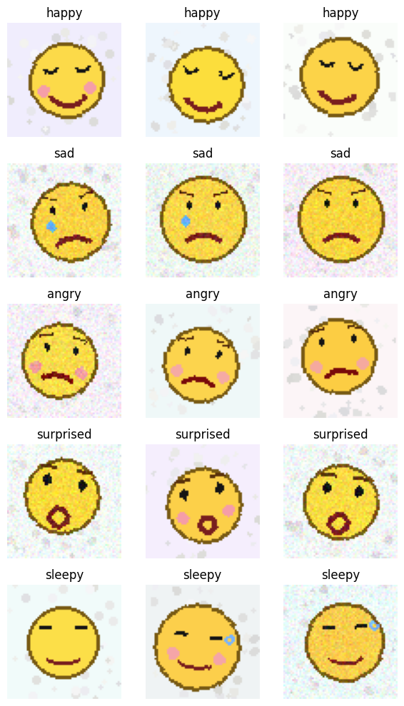
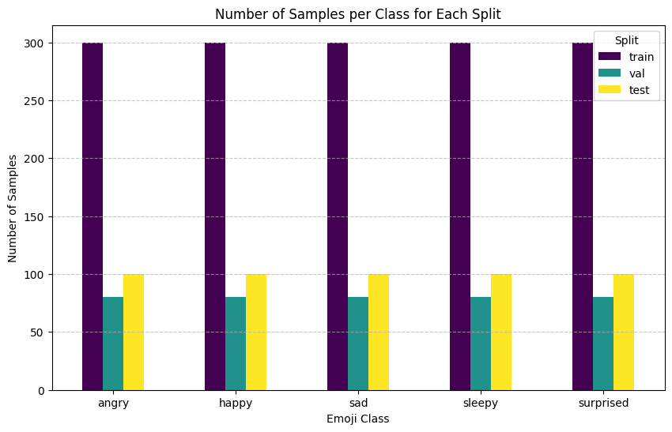
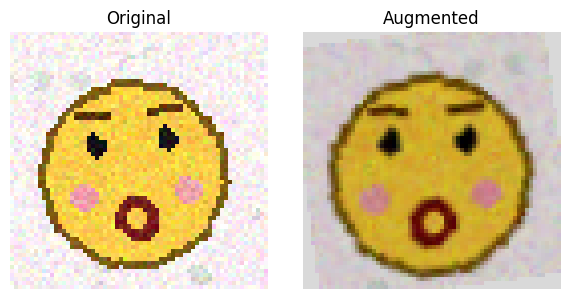
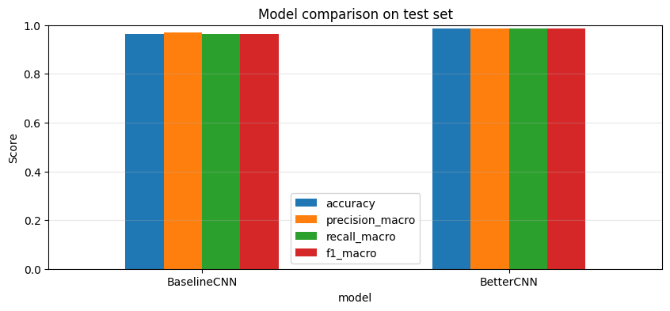
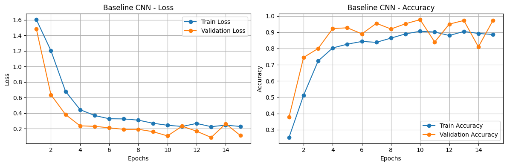
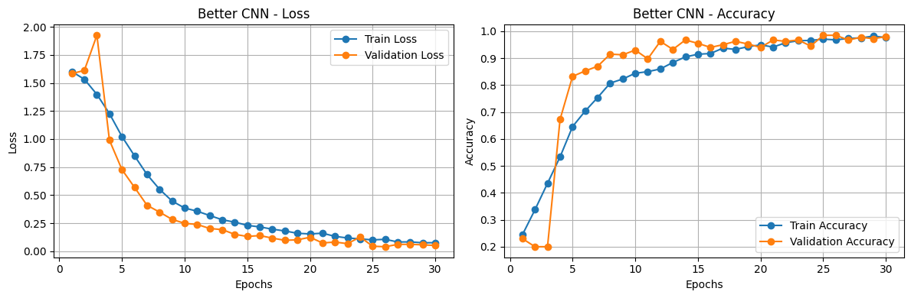
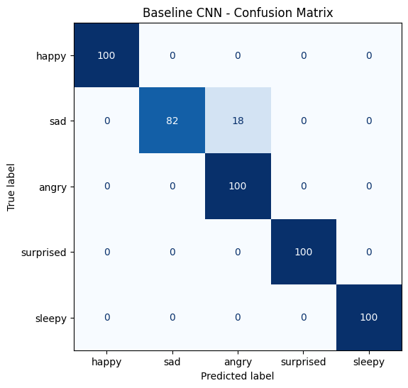
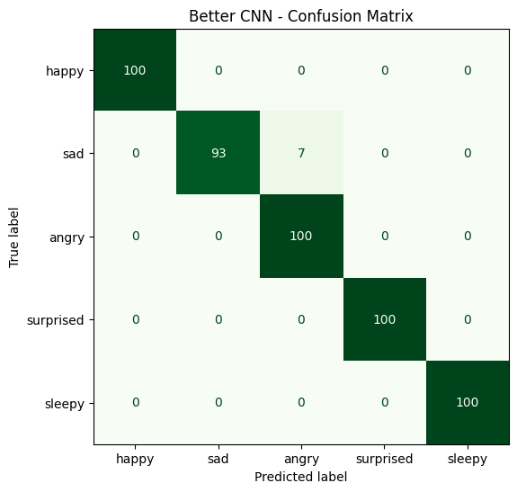
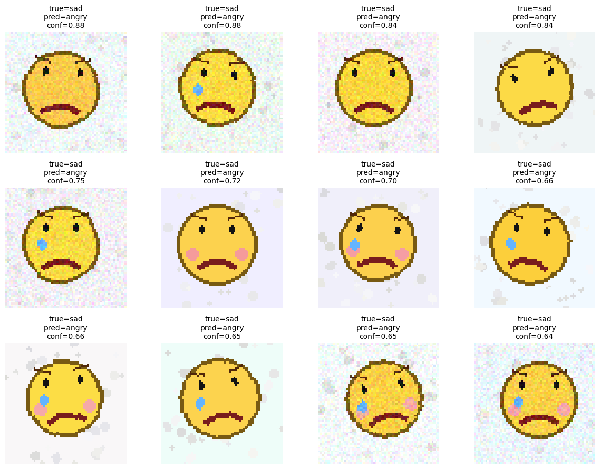

# Deep Learning: Emoji Emotion Classification with Custom CNNs

An end-to-end PyTorch implementation of custom Convolutional Neural Networks (CNNs) built from scratch to classify the emotional state of procedurally generated emoji images.

## Objective
The goal of this project is to classify synthetic 64x64 RGB emoji images into one of five emotional categories: `happy`, `sad`, `angry`, `surprised`, and `sleepy`[cite: 1]. To test model robustness, the dataset generator introduces heavy rotations, Gaussian blur, soft noise, background clutter, and rectangular occlusions[cite: 1].

---

## Project Structure
```text
EmojiClassification/
├── data/
│   └── generator.py             # Procedural emoji generator, augmentations, and PyTorch Dataset
├── models/
│   └── cnn.py                   # BaselineCNN and BetterCNN (Optimized) architectures
├── utils/
│   └── evaluation.py            # Evaluation metrics, confusion matrices, and feature map plots
├── notebooks/
│   └── EmojiClassification.ipynb      # Full interactive Jupyter Notebook with EDA and visual outputs
├── outputs/                     # Saved plots and visual results from the notebook
│   ├── augmented.png
│   ├── baseline_cnn_cm.png
│   ├── baseline_cnn_curves.png
│   ├── baseline_cnn_mistakes.png
│   ├── better_cnn_cm.png
│   ├── better_cnn_curves.png
│   ├── class_examples.jpg
│   └── models_comparison.png
│   └── samples_per_class.png
├── train.py                     # CLI script to train and benchmark both models
├── requirements.txt             # Project dependencies
├── .gitignore                   # Ignored files and directories
└── README.md                    # Project documentation
```

## Results

### Class examples


### Samples per class


### Augmentation


### Model comparison


### Training curves
| BaselineCNN |
|---|
|  |

| BetterCNN |
|---|
  |

### Confusion matrices
| BaselineCNN | BetterCNN |
|---|---|
|  |  |

### BaselineCNN mistakes


